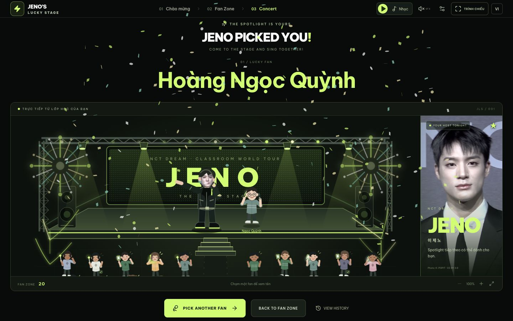

# JENO’S LUCKY STAGE

Concert tương tác chọn ngẫu nhiên học sinh, chạy hoàn toàn trong trình duyệt. React + Vite + TypeScript strict, Motion, SVG tự vẽ, canvas-confetti và Web Audio API. Không cần backend, tài khoản hay API key.

[**Mở bản chạy thử**](https://phamanhduong-jeno.toastyball5.chatgpt.site)



Đây là fan project phục vụ lớp học và mục đích portfolio, không liên kết hay được bảo trợ bởi Jeno, NCT DREAM hoặc SM Entertainment. Tên và nhãn hiệu liên quan thuộc về chủ sở hữu tương ứng.

## Cài đặt và chạy

Cần Node.js 20+ và pnpm. Trong thư mục dự án:

```bash
pnpm install
pnpm dev --port 5173
```

Mở địa chỉ Vite in ra, mặc định `http://127.0.0.1:5173`. Có thể dùng npm (`npm install`, `npm run dev -- --port 5173`) nếu máy không có pnpm. Lockfile được bàn giao là pnpm.

Trên máy Mac đang dùng Codex, có thể mở `start-local.command`; script tự tìm Node/pnpm của Codex khi chưa có Node trong PATH. Không thay đổi cấu hình hệ thống.

```bash
pnpm typecheck
pnpm lint
pnpm test
pnpm build
pnpm preview --port 5174
```

Build tĩnh nằm trong `dist/`. Hãy phục vụ qua HTTP localhost; không mở `index.html` trực tiếp bằng `file://`.

## Nhập danh sách lớp

1. Bấm **ENTER THE CONCERT** để vào Fan Zone.
2. Kéo thả hoặc chọn **XLSX, CSV, TXT, DOCX** (tối đa 10 MB).
3. Kiểm tra preview, sheet/bảng được đề xuất, họ tên và mã. Có thể sửa từng dòng, bổ sung hoặc xóa dòng.
4. Mở “Kiểm tra cột tên và mã học sinh” để chọn cột khác, ghép cột họ/đệm với tên, hoặc chỉnh dòng tiêu đề. Khi cột chưa chắc chắn, phải kiểm tra và xác nhận đề xuất.
5. Với tên trùng không có mã hoặc mã trùng, chọn giữ các dòng đã kiểm tra hoặc loại bản sao trong preview. Hai tên giống nhau với hai mã khác nhau được giữ riêng.
6. Chọn thay toàn bộ hoặc nối vào lớp hiện tại, đặt tên lớp tùy chọn, rồi **XÁC NHẬN**. Import lỗi và hủy preview giữ nguyên lớp đang dùng.
7. Chọn 1–5 fan mỗi lượt và **GO TO CONCERT**.

Tải mẫu ở nút “Tải file mẫu” hoặc dùng `public/sample-class.csv` (40 học sinh). Nút “Thử lớp mẫu 40 fan” cũng mở preview để xác nhận. “Thêm / sửa fan” cho phép bổ sung, sửa, xóa thủ công; sửa tên giữ nguyên ID.

CSV hỗ trợ dấu phẩy, chấm phẩy, tab, BOM và nội dung có dấu ngoặc kép. TXT mỗi tên một dòng, có thể có STT. DOCX hỗ trợ bảng và các đoạn danh sách, kể cả họ tên bị tách thành nhiều run. Không hỗ trợ PDF và Word `.doc`.

## Ảnh mặt Jeno

Đã có ảnh Jeno thật được bundle sẵn: ảnh lớn cạnh sân khấu và crop khuôn mặt gắn vào nhân vật hoạt hình. Ảnh của K-POPIT (TV10), [nguồn Wikimedia Commons](<https://commons.wikimedia.org/wiki/File:LeeJeno-NCTDream-DREAM()SCAPE_Press_Conference_25Mar2024.jpg>), CC BY 3.0. Xem `public/assets/CREDITS.md`.

1. Mở biểu tượng **Cài đặt / Backstage** ở góc trên.
2. Trong **JENO’S LOOK**, bấm **Chọn ảnh mặt**, chọn PNG/JPG/WEBP dưới 5 MB. Nên dùng ảnh rõ mặt, nhìn thẳng, ít nghiêng.
3. Chỉnh **Phóng to**, **Vị trí ngang**, **Vị trí dọc** trong preview toàn thân. Ảnh được clip vào khuôn mặt và chuyển động cùng đầu; tóc/thân/micro vẫn là SVG.
4. **Đặt lại crop** đưa về vị trí ban đầu. **Ảnh Jeno mặc định** khôi phục ảnh có sẵn. Tải ảnh mới để thay ảnh cũ.

Ảnh lưu dưới dạng Blob trong IndexedDB `jeno-face`; crop lưu trong localStorage. Ảnh không gửi đi đâu. Object URL được thu hồi khi thay/gỡ ảnh hoặc unmount. Ảnh hỏng được báo lỗi và không thay ảnh hiện tại.

## Nhạc nền và nhạc NCT

Nút **Nhạc** nhỏ trên header mở/ẩn bảng điều khiển nổi với tua bài, âm lượng, lặp lại và chọn file. **Phát / Tạm dừng** luôn dùng được ngay trên header. Ẩn bảng không ngắt nhạc; bảng mở không thu nhỏ sân khấu. Nhạc không tự phát khi mở trang hoặc reload.

- **Lucky Stage Beat**: bản instrumental mẫu do code tổng hợp cho website, dài khoảng 17 giây và có thể lặp. Đây không phải bài của NCT.
- **CHỌN NHẠC NCT / MP3**: chọn file nhạc bạn có trên máy (`.mp3`, `.m4a`, `.wav`, `.ogg`, `.flac`; tối đa 50 MB), rồi bấm Phát. Trình duyệt kiểm tra xem codec phát được trước khi thay bài.
- Nhạc tùy chọn lưu dạng Blob trong IndexedDB và phục hồi sau reload; luôn ở trạng thái tạm dừng sau reload. File lỗi giữ bài cũ và không tác động danh sách học sinh.
- **Dùng lại nhạc mẫu** khôi phục Lucky Stage Beat.
- Cài đặt **Hạ nhạc khi chọn fan** giảm nhạc nền còn 30% mức âm lượng bạn chọn trong lúc spotlight/công bố, sau đó trả lại mức ban đầu. Nút SFX trên header chỉ điều khiển hiệu ứng click/scanning/countdown/reveal.

Không kèm một bản thu NCT và không tải nhạc từ dịch vụ bên ngoài; để phát bài NCT trong website, chọn file bài đó từ máy của bạn.

## Kỹ xảo sân khấu

Sân khấu có pháo hoa hai bên, vòi tia lửa, laser và dãy đèn nhấp nháy. Khán giả nhún nhảy, vẫy tay, giơ điện thoại/lightstick và cổ vũ nhanh hơn khi spotlight chạy. Lúc công bố fan, pháo giấy bắn hai bên rồi bung thêm một đợt ở giữa. Các hiệu ứng chuyển động tôn trọng tùy chọn **Giảm chuyển động**; nút SFX vẫn điều khiển âm thanh riêng.

## Chọn fan và quản lý vòng

- **LET JENO CHOOSE** chốt kết quả bằng `crypto.getRandomValues` và rejection sampling. Chọn nhiều người không hoàn lại trong cùng lượt.
- Spotlight quét và chậm lại, đếm 3–2–1, Jeno mời từng fan, fan đi từ vị trí thật qua lối giữa và bậc thang, rồi đứng cạnh Jeno với micro.
- **SKIP ANIMATION** giữ nguyên kết quả. Reload giữa lượt phục hồi thẳng màn Reveal của kết quả đã chốt.
- Mặc định **No Repeat**: fan đã gọi không được chọn lại trong vòng. **Allow Repeat** áp dụng cho lượt sau, vẫn không trùng trong cùng lượt.
- Khi hết người, phải chọn **Reset Round**. Reset xóa tập đã gọi, tăng số vòng và giữ lịch sử. Nếu số fan mỗi lượt vượt số còn lại, ứng dụng báo rõ và cho giảm.
- Thay toàn bộ lớp tạo ID lớp/vòng mới; lịch sử lớp cũ được giữ riêng. Nối danh sách giữ vòng đang dùng.
- Lịch sử lưu tên tại thời điểm chọn, mã, lớp, thời gian, thứ tự và vòng. Có lọc lớp hiện tại/mọi lớp, xuất CSV UTF-8 BOM và **Clear History** riêng.

## Trình chiếu và khả năng sử dụng

Tiếng Việt mặc định, có English; Sound ON/OFF; Fast/Normal/Dramatic; nút **TRÌNH CHIẾU** mở fullscreen với bố cục máy chiếu dự phòng; Reduced Motion cũng tôn trọng cài đặt thiết bị. Âm thanh không tự phát lúc tải trang. Hiệu ứng SFX dùng Web Audio và bật/tắt riêng với nhạc nền. Không tạo giọng Jeno.

Bố cục Concert trên máy tính dành phần lớn chiều cao cửa sổ cho sân khấu, thu gọn tiêu đề, số liệu và thanh chọn fan. Sân khấu tự điều chỉnh bề ngang theo khung để nhân vật lớn hơn mà giữ đúng tỉ lệ. Zoom 100–250% vẫn dùng được. Chạm hoặc focus một fan để đọc tên đầy đủ. Nhấn Space/Enter để chọn trên màn Concert; phím không chọn khi đang nhập liệu, mở dialog hoặc trong lượt đang chạy. Các dialog giữ focus và đóng bằng Escape.

Roster, lịch sử, lượt đang thực hiện và cài đặt lưu trong localStorage có version (`jeno-lucky-stage:v1`). Nếu dữ liệu lỗi hoặc quota bị chặn, ứng dụng báo rõ; phiên hiện tại vẫn dùng được. Storage riêng theo trình duyệt và địa chỉ/port. Xóa dữ liệu trình duyệt sẽ làm mất dữ liệu đã lưu. Chưa triển khai service worker/caching, nên không bảo đảm reload offline. Sau khi trang và thư viện import đã tải, chức năng cốt lõi không dùng dịch vụ ngoài.

## Cấu trúc

- `components/ConcertScene.tsx`: sân khấu, crowd, spotlight và đường chuyển động.
- `components/Characters.tsx`: nhân vật khán giả và Jeno có khớp chuyển động; ngoại hình từ hash ID.
- `ClassFileImporter`, `StudentEditor`: parser preview, xác nhận và chỉnh danh sách.
- `SettingsPanel`, `HistoryPanel`, `Modal`: cài đặt, crop và lịch sử có hỗ trợ bàn phím.
- `lib/randomPicker.ts`, `model.ts`: random và trạng thái vòng, độc lập hoạt ảnh.
- `lib/useSelection.ts`: trình tự scanning/countdown/inviting/revealed, dọn timer khi đổi lượt/unmount.
- `lib/storage.ts`, `csvExport.ts`, `audio.ts`: lưu dữ liệu/ảnh, xuất CSV, âm thanh.

XLSX và Mammoth được tải dưới dạng chunk riêng khi nhập file tương ứng. Font Be Vietnam Pro được bundle tại chỗ. Không có dependency CDN trong lúc sử dụng.

## Giấy phép

Mã nguồn phát hành theo [MIT License](LICENSE). Ảnh Jeno trong `public/assets/` dùng giấy phép CC BY 3.0 và có thông tin tác giả/nguồn riêng trong `public/assets/CREDITS.md`.

## Kiểm thử

`pnpm test` có 22 kiểm thử có ý nghĩa cho parser, random, vòng chọn, reload, quota, Unicode/CSV và bố trí 40/60/100 nhân vật. Fixtures tái lập nằm trong `tests/fixtures/`. Xem `QA.md` để biết các kiểm tra UI, ảnh chụp thực tế và giới hạn kiểm chứng.

Fan-made experience · Just for fun. Không phải sản phẩm chính thức của Jeno hoặc NCT DREAM.
